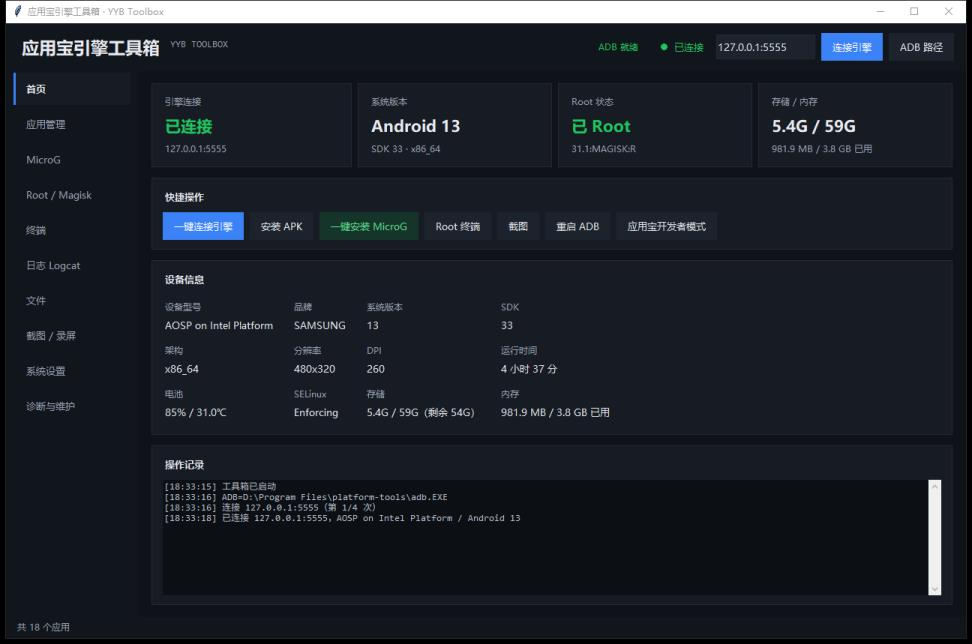

# 应用宝引擎工具箱 · YYB Toolbox

> A WSA-Toolbox-style desktop debugger for Tencent 应用宝 (Androws) Android engine on Windows.
> Pure Python standard library — tkinter + adb, no third-party dependencies.

仿「WSA 工具箱」的 Windows 桌面调试工具，用来管理**腾讯应用宝电脑版**内置的 Android 引擎
（Androws / AOSP on Intel Platform，ADB 端口 `127.0.0.1:5555`）。

单文件 exe，免安装、免 Python；也能直接跑源码。



## 功能

| 模块 | 能力 |
| --- | --- |
| 首页 | 引擎/系统/Root/存储状态卡片，设备信息，操作记录，快捷入口 |
| 应用管理 | APK 安装、启动、停止、清除数据、卸载、禁用/启用、导出 APK、权限授予/撤销、应用详情 |
| MicroG | **一键安装/修复 microG Services + Companion**：自动下载最新版、签名冲突时备份并卸载旧 GMS、安装、授权、电池白名单、检测 FakeGApps/LSPosed 签名伪装 |
| Root / Magisk | Root 状态、Magisk 版本、Zygisk/LSPosed 检测、模块列表、安装/启用/禁用/删除模块、Root Shell、`/system` 读写挂载、SELinux |
| 终端 | 设备内 Shell，支持 `su` 执行、快捷命令、历史输出 |
| 日志 | 实时 Logcat，按级别/关键字/Tag 过滤，暂停、保存 |
| 文件 | 浏览 `/sdcard` 等目录（支持 Root 浏览）、上传/下载、新建/删除 |
| 截图 / 录屏 | 一键截图并预览、保存，`screenrecord` 录制 15/60 秒并拉回本地 |
| 系统设置 | 分辨率、DPI、旋转、动画缩放、保持唤醒、输入文本 |
| 诊断 | adb/设备/端口/进程检查，启动应用宝、结束引擎进程、开发者模式指引、system.vhd 目录定位 |

## 下载

到 [Releases](https://github.com/cuibolan/yyb-toolbox/releases) 下载 `YYBToolbox.exe`（约 12 MB，单文件，双击即用）。

> 未签名，首次运行若遇 SmartScreen 提示「未知发布者」，点「更多信息 → 仍要运行」。

从源码运行：

```bash
python yyb_toolbox.py          # 需要 Python 3.10+，自带 tkinter
python yyb_toolbox.py --selftest   # 无界面自检：连引擎、读设备信息、截图
```

## 快速开始

1. 打开「腾讯应用宝电脑版」，随便启动一个应用/游戏，等 Android 引擎起来（约 10~30 秒）。
2. 启动工具箱，它会自动寻找 adb 并连接 `127.0.0.1:5555`。
3. 顶部显示「已连接」即可使用。

### adb：自动识别，缺了就自动安装

1. 工具箱自己的 `tools\platform-tools\adb.exe`（自动安装的位置）；
2. 环境变量 `ADB_PATH`、系统 `PATH` 里的 adb；
3. `D:\Program Files\platform-tools\adb.exe`、`C:\platform-tools\adb.exe`、
   `%LOCALAPPDATA%\Android\Sdk\platform-tools\adb.exe` 等常见路径；
4. **应用宝自带的 adb**：`应用宝安装目录\Application\<版本号>\adb.exe`（逐版本扫描）；
5. 都没有时，启动会询问是否下载 Google 官方 platform-tools（约 17 MB），
   装到 `tools\platform-tools\`，校验 `adb version` 后写入配置并自动连接。

### 开启 ADB / 开发者模式

应用宝电脑版从 5.10.27.10 起默认关闭 ADB，需要手动打开一次：

1. 应用宝右上角「≡」→ 设置；
2. 在设置页**连续点击「性能」7 次**，进入开发者模式；
3. 勾选「开启开发者模式」，保存。

## 一键 microG

microG 完整生效需要两件事，工具箱都管：

1. **microG 本体**：`com.google.android.gms`（microG Services）+ `com.android.vending`（microG Companion）+ 'microggsf'(https://github.com/microg/android_packages_apps_GsfProxy/releases)；
2. **签名伪装**：Magisk + LSPosed + FakeGApps。没有 FakeGApps 时工具箱会自动下载安装，
   之后在 LSPosed 里启用 FakeGApps、作用域勾选「系统框架」，重启引擎生效。

若引擎装的是官方 GMS（版本号不是 `0.3.x`），签名会冲突，工具箱会先备份为
`cache/backup_gms.apk` 再卸载。已在 Android 13 / x86_64 引擎上验证 microG 0.3.18 +
FakeGApps 6.6 + LSPosed 2.2.1 正常工作。

## LSPosed / Zygisk Next / Magisk 版本与安装顺序

三个组件都建议用**官方最新版**，按下面顺序装（除 manager.apk 外都是当 Magisk 模块刷入）：

| 组件 | 用什么版本 | 下载 |
| --- | --- | --- |
| Magisk | **原版**（topjohnwu 官方，不是各种分支/改版） | [releases/latest](https://github.com/topjohnwu/Magisk/releases/latest) |
| Zygisk Next | **最新版**（Dr-TSNG 官方） | [releases/latest](https://github.com/Dr-TSNG/ZygiskNext/releases/latest) |
| LSPosed | **最新版**（官方 LSPosed 或 JingMatrix 的 Vector 分支，二选一） | [LSPosed/latest](https://github.com/LSPosed/LSPosed/releases/latest) · [Vector/latest](https://github.com/JingMatrix/LSPosed/releases/latest) |
| FakeGApps | 最新版（签名伪装用） | [releases/latest](https://github.com/whew-inc/FakeGApps/releases/latest) |

1. **Magisk 装原版**：只用 topjohnwu/Magisk 的官方 APK（当前 v31.1，`Magisk-v31.1.apk`）。
   本项目的 system.vhd 方案刷出来的引擎自带 Magisk 原版 31.1，一般不用再装；要升级就在引擎内
   用官方 APK 覆盖安装，别用第三方改版，否则模块、Zygisk 行为都可能对不上。
2. **Zygisk Next 装最新版**：下载 `Zygisk-Next-<版本>-release.zip`，在「Root / Magisk → 安装
   Magisk 模块」里刷入，然后重启引擎。它是 Zygisk 的实现底座，LSPosed 依赖它。
3. **LSPosed 装最新版（关键一步）**：刷入 `LSPosed-v<版本>-<构建号>-zygisk-release.zip` 后，
   **必须从这个 zip 里解压出 `manager.apk` 并安装**（应用管理页「安装 APK」或 `adb install` 都行）。
   原因：新版 LSPosed 的管理器不再单独发布/上架，只放在模块 zip 内；只刷 zip 不装 manager.apk，
   模块虽然被加载，但**没有管理器界面**，看不到模块列表、也没法勾选作用域，等于无法管理模块。
   > 工具箱已内置这一步：刷模块 zip 时会自动扫描 `manager.apk` 并询问是否一并安装；
   > 也可以用 Root / Magisk 页的「装模块自带 APK」单独提取安装（会自动跳过 LSPosed 内部的 `daemon.apk`）。
4. **FakeGApps**：刷入模块后打开 LSPosed 管理器 → 模块 → 启用 FakeGApps → 作用域勾选
   「系统框架」→ 重启引擎，microG 的签名伪装才生效。

本机实测通过的一套组合：Magisk 31.1 + Zygisk Next 1.5.3 + LSPosed 2.2.1 (7912) +
FakeGApps 6.6 + microG 0.3.18。

## Root / 没有 Root 怎么办

引擎自带 `su`（Magisk）时工具箱会识别为已 Root，解锁模块管理；未 Root 时可走社区成熟的
**替换 system.vhd** 方案（[原教程](https://www.coolapk.com/feed/68039703)）：

1. 完全退出应用宝（含托盘），结束所有 `Androws*` 进程；
2. 备份 `应用宝安装目录\Androws\Image\<当前版本>\system.vhd`；
3. 用 `qemu dd` 从 system.vhd 提取 boot，应用宝内 Magisk「修补一个文件」；
4. 修补产物重命名 `2.boot_a`，用「应用宝root.bat」生成新的 system.vhd；
5. 替换回原路径，重启应用宝。

工具箱「Root / Magisk → 未 Root？刷入方案」有完整指引，并能直接打开 system.vhd 目录。
**只替换 system.vhd，别动 data.vhd；替换前务必备份。**

## 自行打包 exe

```bat
py -m pip install pyinstaller
py -m PyInstaller --noconfirm --clean --onefile --noconsole ^
  --name YYBToolbox --icon app.ico --add-data "app.ico;." ^
  --version-file version_info.txt yyb_toolbox.py
```

或直接双击 `build_exe.bat`。生成物在 `dist\`，改名为 `YYBToolbox.exe` 即可分发。
源码已处理 `sys.frozen`：打包后 `cache/`、`screenshots/`、`config.json` 落在 exe 同级目录。

## 常见问题

**连接失败 / connection refused**：先确认引擎已启动（开个应用等 20 秒）；装了 WSA 或其他模拟器先退出，避免 5555 冲突。

**列表里出现 emulator-5554**：和 `127.0.0.1:5555` 是同一引擎，工具箱会自动选用。

**截图是黑屏**：引擎显示层带 `FLAG_SECURE` 保护，`screencap` 只能拿到黑图，属系统限制；录屏同样可能失败，可用 Win+Shift+S。

**修改分辨率后界面异常**：应用宝自身会缩放画面，点「系统设置 → 重置」或重启引擎。

**Hyper-V 异常**：应用宝设置里有「修复工具」，或在「启用或关闭 Windows 功能」中修复 Hyper-V。

## 说明

- 本项目与腾讯、Google、microG 官方无关，仅为本地调试工具；
- 修改系统镜像、Magisk 模块、卸载 GMS 等操作有风险，请自行备份；
- 仅支持 Windows（依赖 adb 与 tkinter）。

## License

[MIT](LICENSE)
